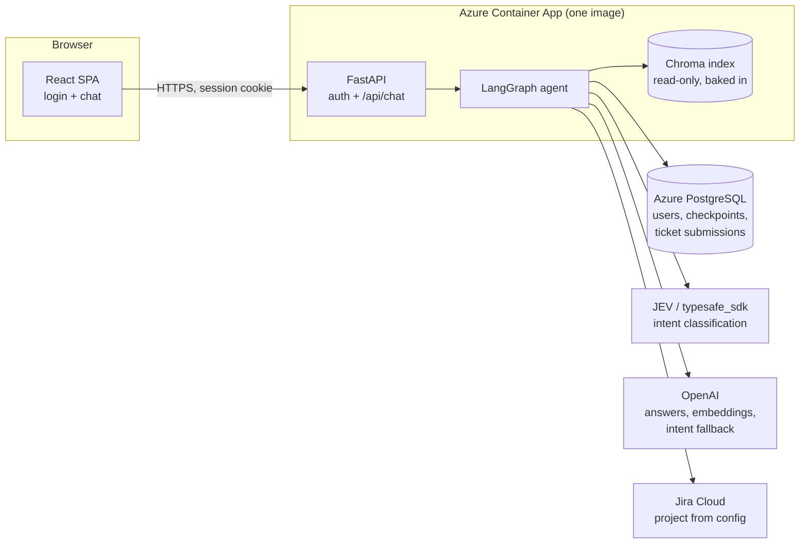
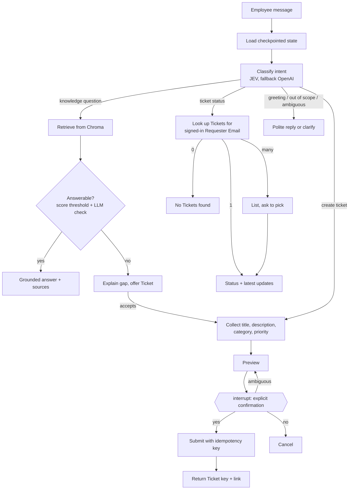
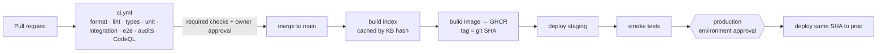

# Tier0 AI — Project Plan

Tier0 AI is a conversational first-line IT & HR help desk for the fictional company BuzzTech Solutions. It answers Employee questions from a knowledge base, offers to raise a Ticket when it can't answer, and reports the status of the Employee's existing Tickets. Requirements come from `SmartDesk_AI_Complete_Specification.md`, and the delivery process from `project.txt`. Terms follow `GLOSSARY.md`, and decisions that depart from the spec are recorded in `docs/adr/`.

**Status:** Draft, awaiting approval (2026-11-05).

## 1. Architecture



The FastAPI backend serves the built React app, so there's one origin, no CORS, and one deployable unit.

### Agent graph



The Requester Email always comes from the signed-in session, never from the chat ([ADR 0001](docs/adr/0001-signed-in-email-is-requester-email.md)).

## 2. Technology choices

| Concern | Choice | Reason |
|---|---|---|
| Backend language | Python 3.12 | Python is specified. The container uses 3.12 because some of the dependencies may not support 3.14 yet. |
| Orchestration | LangGraph | Specified. Already used in `ingest.py`. `interrupt()` handles the confirmation step. |
| Conversation state | LangGraph `PostgresSaver` | State survives restarts and multiple replicas. |
| Intent classification | JEV via `typesafe_sdk`, falling back to OpenAI structured output | Keeps the existing approach and gives a real LLM fallback (UC-09, AT-14). |
| Answers and embeddings | OpenAI (`ChatOpenAI`, `text-embedding-3-small`) | Owner already has a key. Used by the existing code. |
| Vector store | Chroma, index baked into the image | See [ADR 0002](docs/adr/0002-chroma-index-baked-into-image.md). |
| Relational DB | PostgreSQL (Azure Flexible Server) | Specified. Holds checkpoints, users and ticket submissions. |
| Ticketing | Jira Cloud via the `jira` library | Already integrated, and its query language (JQL) can search by Requester Email. No local email-to-ticket mapping needed. |
| API | FastAPI + Pydantic | Typed request and response contracts, async, easy to test. |
| Frontend | React + TypeScript + Vite | React is specified. Vite produces a static build that FastAPI serves. |
| Python tooling | uv, ruff (format and lint), mypy, pytest | Fast and reproducible. One tool per job. |
| Frontend tooling | ESLint, `tsc`, Vitest | Standard for Vite projects. |
| E2E tests | Playwright | Specified. |
| Hosting | Azure Container Apps (Consumption) + PostgreSQL Flexible Server B1ms | Cheapest and simplest. Apps scale to zero. |
| Container registry | GitHub Container Registry (public) | Free for public repos. |
| Infrastructure as code | Bicep | Native to Azure, nothing to install beyond `az`. |
| CI/CD | GitHub Actions, OIDC sign-in to Azure | No Azure password stored in GitHub. Least-privilege roles. |

## 3. Components and repository layout

```text
tier0-ai/
├── backend/
│   ├── pyproject.toml
│   ├── src/tier0/
│   │   ├── config.py            # pydantic-settings; all env vars
│   │   ├── api/                 # FastAPI app, auth, chat routes, static SPA
│   │   ├── auth/                # demo-user seeding, password hashing, sessions
│   │   ├── agent/               # graph.py, state.py, nodes/
│   │   ├── intent/              # intent.py types, JEV client, OpenAI fallback
│   │   ├── rag/                 # loader, schema, indexer, retriever, answerability
│   │   ├── tickets/             # TicketAdapter protocol, JiraAdapter, FakeAdapter
│   │   ├── llm/                 # provider clients, retry/timeout policy, fakes
│   │   └── observability/       # structured logging, correlation IDs, redaction
│   ├── scripts/                 # build_index.py, inspect_retrieval.py, run_eval.py
│   └── tests/{unit,integration}/
├── frontend/                    # React + Vite + TS
├── e2e/                         # Playwright tests
├── data/
│   ├── knowledge_base/          # qa_dataset.json (pruned) + synthetic/*.json
│   ├── fixtures/                # small KB used by CI and e2e tests
│   └── evaluation/              # retrieval_cases, knowledge_gaps, conversation_cases
├── tools/build_qa_dataset.py    # offline dataset builder (not part of the app)
├── infra/                       # main.bicep + modules
├── docker-compose.yml           # local + CI e2e stack (app + postgres)
├── Dockerfile                   # multi-stage: frontend build → index → runtime
├── .github/workflows/           # ci.yml, deploy.yml, eval.yml, infra.yml
├── docs/{adr/,architecture.md,design-decisions.md,evaluation-report.md,demo-script.md}
├── GLOSSARY.md  PROJECT_PLAN.md  PRODUCT_BACKLOG.md  CHANGELOG.md  README.md
```

Existing code gets folded in as follows:
- `ingest.py` is split into the `rag/` modules and `agent/`.
- `graph.py`'s demo loop becomes an integration test and a CLI script.
- `issue_tracker.py` becomes `tickets/jira_adapter.py`, with these fixes:
  - return the created issue
  - raise typed errors instead of hiding them
  - quote and escape the email in JQL queries
  - fetch comments
  - drop the "Bug: " prefix
  - read the project key from config
  - add the environment label
  - connect to Jira only when first used

## 4. Database design (PostgreSQL)

Each environment gets its own database (`tier0_staging`, `tier0_prod`) on one shared server. Schema changes are versioned migrations (Alembic).

```text
users
  id             uuid  pk
  email          text  unique not null      -- Requester Email
  display_name   text  not null
  password_hash  text  not null             -- argon2
  created_at     timestamptz

ticket_submissions                           -- duplicate protection (FR-TKT-06)
  id               uuid  pk                  -- idempotency key, created at preview time
  thread_id        text  not null
  requester_email  text  not null
  payload_hash     text  not null
  status           text  not null            -- pending | submitted | failed | unknown
  ticket_key       text  null                -- e.g. SUP-123
  created_at, updated_at  timestamptz

LangGraph checkpoint tables                  -- created by PostgresSaver.setup()
```

Demo users are created at startup from `DEMO_USERS` (JSON of email, name and password, supplied as a secret). The app inserts any missing users and never overwrites existing ones.

If a submission has `status = unknown` (the request timed out), a retry first searches Jira for a ticket carrying the label `tier0-sub:<id>` before creating a new one. That's what prevents duplicates (AT-18).

## 5. API contracts

All endpoints except `/api/health` and `/api/auth/login` require a session cookie (HttpOnly, Secure, SameSite=Lax, signed and short-lived).

| Method | Path | Request | Response |
|---|---|---|---|
| GET | `/api/health` | – | `200 {status:"ok"}` (container liveness) |
| GET | `/api/ready` | – | `200` once the DB is reachable and the index is loaded, `503` otherwise |
| POST | `/api/auth/login` | `{email, password}` | `204` + cookie, or `401`. Rate-limited. |
| POST | `/api/auth/logout` | – | `204` |
| GET | `/api/auth/me` | – | `{email, display_name}` |
| POST | `/api/chat` | `{thread_id?: string, message: string}` | `ChatResponse` |
| GET | `/api/chat/{thread_id}` | – | message history for that thread (owned by the caller) |

```jsonc
// ChatResponse
{
  "thread_id": "uuid",
  "reply": "markdown text",
  "intent": "knowledge|create_ticket|ticket_status|smalltalk|out_of_scope|ambiguous",
  "sources": [{"document_id": "...", "title": "...", "category": "..."}],
  "pending_action": null | {
    "type": "confirm_ticket",
    "preview": {"requester_email": "...", "title": "...", "description": "...", "category": "IT|HR", "priority": "Low|Medium|High|Critical"}
  } | {
    "type": "select_ticket",
    "options": [{"ticket_key": "SUP-12", "title": "...", "status": "..."}]
  },
  "ticket": null | {"ticket_key": "SUP-12", "url": "https://...", "status": "..."}
}
```

The UI's Confirm and Cancel buttons just send "yes" and "no" as ordinary messages. The graph decides what counts as a clear yes, so typed and clicked confirmations go through the same code path. That covers AT-08.

Threads belong to the signed-in user, so requests for another user's `thread_id` return `404`.

## 6. Security

- **Secrets:** OpenAI key, JEV key, Jira token, `DEMO_USERS`, session signing key and DB URL.
  - Stored as GitHub Environment secrets and copied to Container Apps secrets at deploy.
  - Never committed. `.env.example` has placeholders only.
  - GitHub secret scanning and push protection are on.
- **Identity:** [ADR 0001](docs/adr/0001-signed-in-email-is-requester-email.md). Ticket lookups are always filtered to the session's Requester Email *and* `tier0-env:<env>`.
  - Typing a ticket key or email in the chat never widens access.
- **LLM safety:**
  - Retrieved content and user input are treated as untrusted and wrapped as data in prompts.
  - Tool arguments are validated with Pydantic in code.
  - Authorization and confirmation decisions are made in code, never by the LLM.
- **Jira:**
  - JQL values are quoted and escaped.
  - The project key comes from config.
  - The API token belongs to a dedicated Jira user with access to that project only.
- **GitHub Actions:**
  - `permissions:` default to `contents: read`, granted per job.
  - Azure access uses OIDC with roles scoped to the resource group.
  - PRs from forks get no secrets.
  - The `production` environment requires owner approval.
- **Dependencies:** Dependabot, `pip-audit`, `npm audit`, and CodeQL for Python and TypeScript.
- **Logging:**
  - Logs are structured JSON with a correlation ID per request.
  - Emails are masked, and keys, tokens, auth headers and message bodies are never logged at INFO.

## 7. Testing strategy

| Tier | Scope | Runs | External calls |
|---|---|---|---|
| Unit | KB schema and loader, chunking, answerability logic, intent parsing, ticket payload validation, Jira mapping and JQL escaping, retry/timeout, auth | Every PR | None. Fake LLM, fake embeddings, fake ticket adapter. |
| Integration | Index build and retrieval on the fixture KB, graph flows across turns with `PostgresSaver` (Postgres service container), API routes, failure paths | Every PR | None |
| E2E (Playwright) | Login, plus AT-01…AT-18 through the real UI on `docker compose`, with the app started using fake providers | Every PR | None |
| Smoke (Playwright) | Login, one knowledge-base answer, one status lookup | After each staging deploy | Real OpenAI, JEV and Jira |
| Evaluation | Recall@k, groundedness, routing accuracy, escalation rate, ticket flows, latency, cost | Nightly + manual | Real providers, `tier0-env:staging` |

Fakes are chosen by config (`LLM_PROVIDER=fake`, `TICKETING_PROVIDER=fake`), so PR checks are deterministic, free, and need no secrets. Evaluation results go into `docs/evaluation-report.md` as measured numbers, not targets.

## 8. CI/CD and deployment



- **`ci.yml`** runs on PRs. It's required by branch protection on `main`, along with one approving review.
- **`deploy.yml`** runs on pushes to `main`:
  - Builds the index only when the KB-hash cache misses.
  - Uses a multi-stage Dockerfile and pushes the image to GHCR.
  - Runs `az containerapp update` for staging, then the smoke tests.
  - Waits for approval on the `production` environment, then deploys the same image.
- **`infra.yml`** runs manually and when `infra/` changes on `main`. It deploys `main.bicep`, with approval required on the `production` environment.
- **`eval.yml`** runs nightly and on demand, and uploads the evaluation report as an artifact.

**Azure resources** (one resource group `rg-tier0`, region `eastus`):

| Resource | SKU | Est. monthly cost |
|---|---|---|
| Container Apps environment + `ca-tier0-staging` + `ca-tier0-prod` | Consumption, min replicas 0 | ~$0–3 (within the free allowance) |
| PostgreSQL Flexible Server, DBs `tier0_staging` and `tier0_prod` | Burstable B1ms, 32 GB | ~$13–16 |
| Log Analytics workspace | Pay-per-GB, 30-day retention | ~$0–2 |
| **Total** | | **~$15–20** + OpenAI/JEV usage |

Cold starts after scale-to-zero take about 15–30 seconds. For demos, temporarily set production's minimum replicas to 1.

## 9. Milestones

See `PRODUCT_BACKLOG.md` for tasks and dependencies.

| Milestone | Outcome |
|---|---|
| M0 Foundations | Repo, tooling, PR CI, clean licensed knowledge base with Knowledge Gaps |
| M1 Retrieval | Hash-keyed Chroma index, retrieval evaluation, grounded and answerability-aware answers |
| M2 Tickets | Hardened Jira adapter, status lookup, confirmed and idempotent creation |
| M3 Agent | Intent classification with fallback, full graph on `PostgresSaver` |
| M4 Application | Auth, chat API, React UI, Playwright e2e in CI |
| M5 Azure | Image, Bicep infrastructure, staging and gated production deploys |
| M6 Quality & submission | Evaluation workflow, observability, adversarial tests, docs, demo |

## 10. Known risks

- **The knowledge base is mostly IT ticket resolutions, not policy.** Answers may read like support notes, and Knowledge Gap pruning has to be thorough or escalation tests become unreliable.
- **Index size and cold start:** about 21k vectors (roughly 100-200 MB) in the image. Measure in M5, and if startup is too slow, revisit ADR 0002.
- **Two LLM providers** mean two keys, two failure modes, and the cost of keeping the fallback path tested.
- **Jira API limits on the free tier.** The evaluation and smoke runs must stay small.
- **Spec deviations** (ADR 0001, React and Postgres instead of the spec's Gradio and JSON suggestions) have to be explained to graders in `docs/design-decisions.md`.
