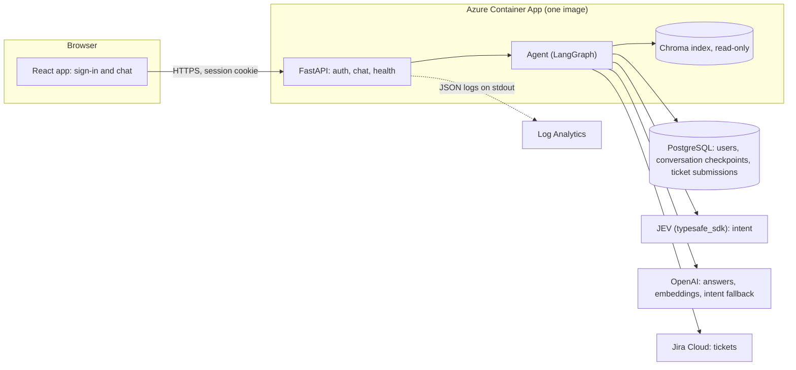
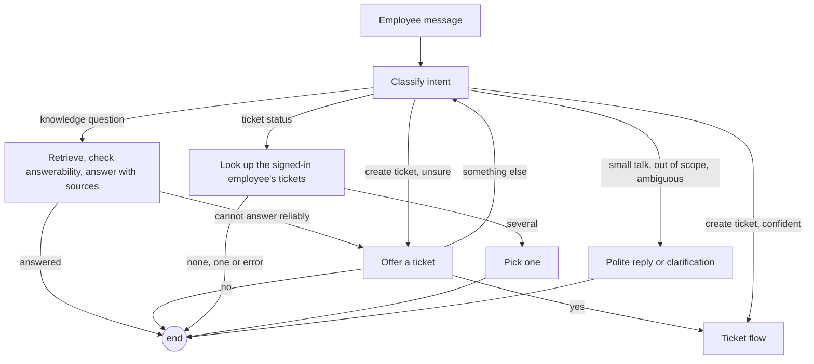
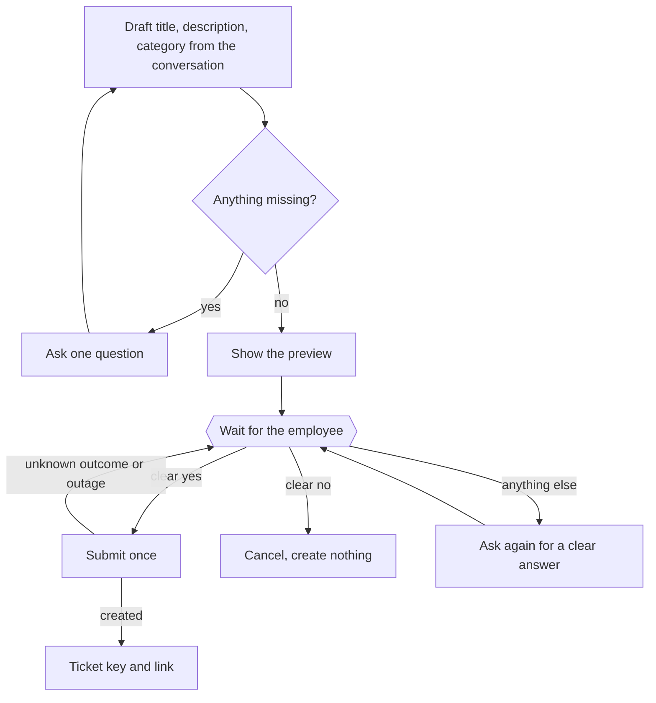

# Architecture

One container image runs the FastAPI backend, which also serves the built React app, so the browser talks to a single origin (no CORS). State lives in PostgreSQL; the knowledge index is read-only files baked into the image ([ADR 0002](adr/0002-chroma-index-baked-into-image.md)).

## System

| Part | Where | Responsibility |
|---|---|---|
| Web app | `frontend/` | Sign-in, chat, source list, ticket preview and ticket pick buttons. Renders every reply as plain text; only `http(s)` links, opened with `noopener noreferrer` |
| API | `backend/src/tier0/api/` | Sessions, CSRF same-origin check, rate limits, request-size cap, security headers and a strict content security policy, request IDs, health and readiness |
| Agent | `backend/src/tier0/agent/` | The conversation graph and ticket flow, checkpointed in PostgreSQL |
| Retrieval | `backend/src/tier0/rag/` | Index build (content-hashed, atomic swap), retrieval, the answerability decision, grounded answers with sources |
| Tickets | `backend/src/tier0/tickets/` | Jira adapter (typed errors), status lookup, drafting, confirmation parsing, duplicate-proof submission |
| Intent | `backend/src/tier0/intent/` | JEV first, OpenAI as the fallback, one clear error if both fail |

## The conversation

Every employee message runs through one graph. It pauses (`interrupt`) whenever it needs the employee's answer, and the next message resumes it, even after a restart, because the state is saved in PostgreSQL.

The requester is always the signed-in employee, never anything typed in the chat ([ADR 0001](adr/0001-signed-in-email-is-requester-email.md)).

## Creating a ticket

What keeps this safe is enforced in code, not left to the language model:

- **No ticket without a clear yes.** Only a reply made entirely of known yes-phrases counts; questions, hedges and mixtures such as "yes but change it" are not a yes. The workflow state machine only allows submission from the confirmation step.
- **No duplicates.** Each draft gets a submission ID, stored with a unique constraint and attached to the Jira ticket as the label `tier0-sub:<id>`. A repeated confirmation, a double click, or a retry after a timeout first looks for that label before creating anything. A timeout is "outcome unknown", never "nothing happened".
- **Fields are validated.** The model's draft is parsed into a fixed schema: category must be IT or HR, text is cleaned and length-limited, and the preview shows exactly what will be sent.
- **State is correct while paused.** Each node records what it is about to ask before waiting, so a saved conversation always matches what the employee saw. The ticket nodes are registered on the main graph, not as a sub-graph, so that this holds.

## Who can see what

- Every status lookup is filtered by the session's email **and** the environment label (`tier0-env:<APP_ENV>`), and results are re-checked in code in case Jira returns more.
- A conversation belongs to the user who started it; anyone else gets a 404 that looks like "not found".
- Internal Jira comments are never shown.
- Test controls (`/api/_e2e/*`) and fake providers exist only when `APP_ENV` is `local` or `e2e`.

## Delivery

```mermaid
flowchart LR
    PR["Pull request"] --> CI["CI: backend, frontend, e2e, image, infra, audit, CodeQL"]
    CI --> M["Merge to main"]
    M --> IDX["Build index (cached by content hash)"]
    IDX --> IMG["Build image, tag with commit SHA, push to GHCR"]
    IMG --> STG["Deploy to staging"]
    STG --> SMK["Smoke tests"]
    SMK --> APR{{"Human approves production"}}
    APR --> PROD["Deploy the same image to production"]
    PROD --> SMK2["Smoke tests, roll back on failure"]
```

Azure sign-in uses short-lived OIDC tokens scoped to one resource group, so no Azure password is stored in GitHub. Details: [Azure setup](azure-setup.md), [rollback](rollback.md). Nightly [evaluation](evaluation-report.md) runs separately and is not a merge gate.

## Data

| Store | Holds | Notes |
|---|---|---|
| PostgreSQL `users` | Demo accounts, password hashes (argon2) | Seeded at start-up from `DEMO_USERS` |
| PostgreSQL `ticket_submissions` | One row per ticket attempt, with status | Partial unique index; the reconciliation key |
| PostgreSQL LangGraph tables | Conversation checkpoints | Only allow-listed classes can be rebuilt from them |
| Chroma files | About 21,000 knowledge entries as vectors | Built outside the image, content-hashed, read-only at run time |
| Jira | The tickets themselves | The system of record; nothing about tickets is copied locally except the submission row |
